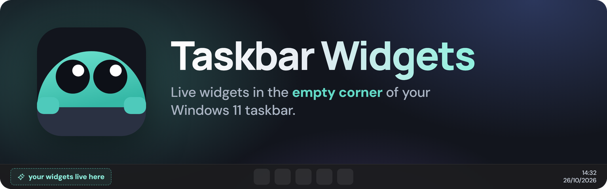
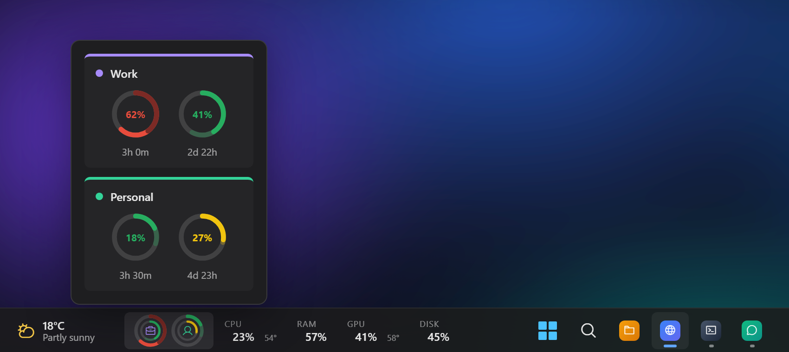
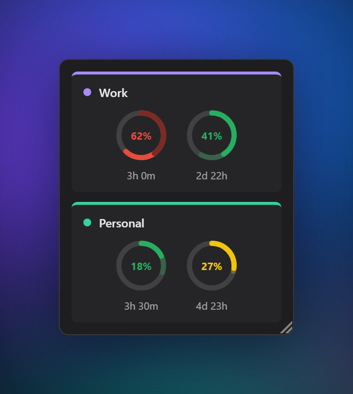
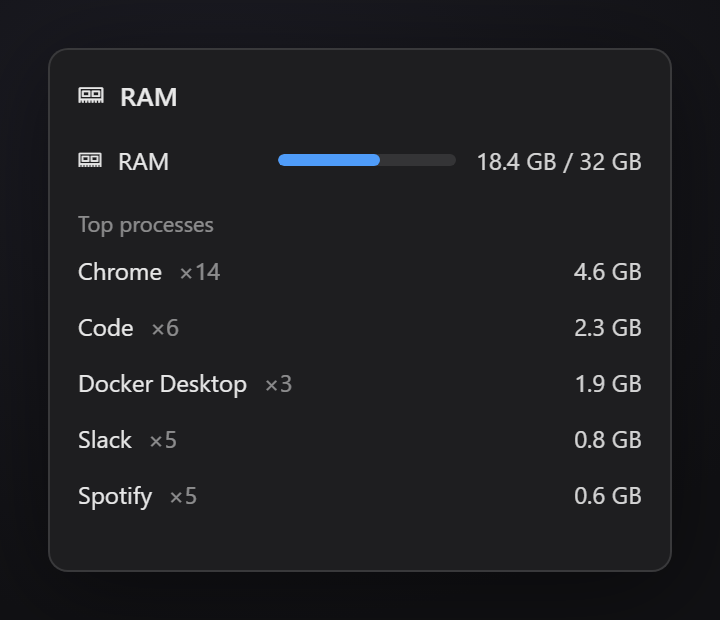
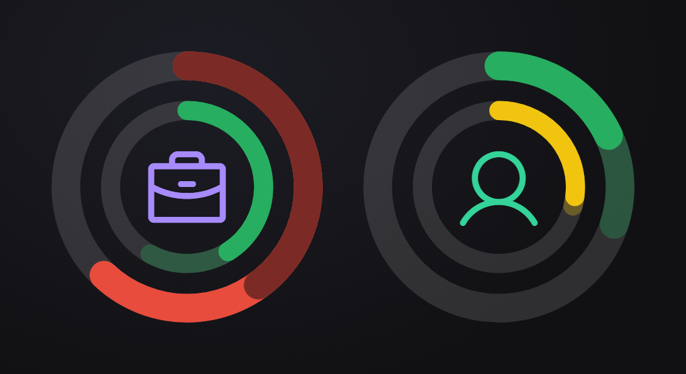

<p align="center">
  <a href="https://github.com/SirBepy/windows_taskbar_widgets/releases/latest"></a>
</p>

<p align="center">
  <b>System stats, Claude usage, Spotify and a Pomodoro timer, living in the empty part of your taskbar.</b>
</p>

<p align="center">
  <a href="https://github.com/SirBepy/windows_taskbar_widgets/releases/latest">Download</a> ·
  <a href="#-widgets">Widgets</a> ·
  <a href="#-claude-usage-and-safe-pace">Safe pace</a> ·
  <a href="#-install">Install</a>
</p>

<p align="center">
  <a href="https://github.com/SirBepy/windows_taskbar_widgets/releases/latest"></a>
  
  
  <a href="https://github.com/SirBepy/windows_taskbar_widgets/commits"></a>
</p>

<p align="center">
  
</p>

<p align="center">
  
  <br><sub>Hover a tile and its flyout opens above the taskbar.</sub>
</p>

## 🧩 Widgets

<table>
  <tr>
    <td width="33%" valign="top">🧠 <b>CPU</b><br>Load, plus temperature when your PC reports it.</td>
    <td width="33%" valign="top">🧮 <b>RAM</b><br>Used out of total memory.</td>
    <td width="33%" valign="top">🎮 <b>GPU</b><br>Load, temperature and VRAM on NVIDIA cards.</td>
  </tr>
  <tr>
    <td valign="top">💾 <b>Disk</b><br>Free space per drive. Opens the drive in Explorer.</td>
    <td valign="top">🤖 <b>Claude usage</b><br>5-hour and weekly limits per account, coloured by <a href="#-claude-usage-and-safe-pace">safe pace</a>.</td>
    <td valign="top">🎵 <b>Spotify</b><br>What's playing, with play / pause.</td>
  </tr>
  <tr>
    <td valign="top">🍅 <b>Pomodoro</b><br>The live timer from <a href="https://github.com/SirBepy/pomodoro-overlay">Pomodoro Overlay</a>.</td>
    <td valign="top">➖ <b>Divider</b><br>Groups tiles. Add as many as you like.</td>
    <td valign="top">🪟 <b>Floating overlays</b><br>Take a widget off the taskbar and float it anywhere on screen.</td>
  </tr>
</table>

Right-click any tile for its shortcuts: Task Manager, Explorer, Open Claude Conductor, Copy track info.

<table>
  <tr>
    <td width="50%" valign="top"><br><sub>🪟 A widget as a floating overlay, resizable from its corner</sub></td>
    <td width="50%" valign="top"><br><sub>🧮 Hover RAM for the top processes</sub></td>
  </tr>
</table>

## 🤖 Claude usage and safe pace

The Claude usage widget reads [Claude Conductor](https://github.com/SirBepy/claude_conductor)'s usage data, read-only. Conductor does not need to be running. When it is, new numbers arrive live, and clicking the tile refreshes every account.

<p align="center">
  
  <br><sub><b>Work</b>: 5h is red, 62% used with the window 40% through. 7d is green, 41% used at 58% through.<br><b>Personal</b>: 5h is green, 18% used at 30% through. 7d is yellow, 27% used at 29% through.</sub>
</p>

Each account gets one dial: **the outer ring is the 5-hour session window, the inner ring is the weekly (7-day) window**, and the account's icon sits in the middle. The flyout and the overlay show the same two windows as separate rings, with the time left until each one resets.

**Safe pace** is how far through the window you are. Two hours into a 5-hour window, safe pace is 40%: keep using it at the rate that got you to 40% and you reach 100% exactly as it resets. Every ring is compared with its own safe pace:

| | Ring | Meaning |
| --- | --- | --- |
|  | more than 10 points under safe pace | plenty of room |
|  | under safe pace, by 10 or less | on track |
|  | at or over safe pace, by less than 10 | slow down |
|  | 10 or more points over | you'll run out before the reset |

- **Under pace**, a faint arc runs ahead of the fill to the safe-pace point: that gap is your headroom.
- **Over pace**, the fill up to the safe-pace point is darkened, so only the overshoot stands out.
- **No reset time known yet**: the ring uses plain thresholds instead, green below 50%, orange from 50%, red from 80%.

Hover a ring to see its exact percentage and safe pace.

## ⚙️ Settings

- 🖥️ **Per monitor**: pick which taskbar gets which widgets, and drag them into order in the settings preview.
- 🎬 **Fullscreen aware**: can hide whenever the taskbar does. When one monitor goes fullscreen, its widgets can move to the other one, and back after.
- 🙈 **Private**: optionally hidden from screen sharing and recordings.
- 🪟 **Overlays**: floating widgets snap to screen edges, resize from a grip, and each has its own opacity.
- 🚀 **Start with Windows**: one switch.

## 📦 Install

<a href="https://github.com/SirBepy/windows_taskbar_widgets/releases/latest"></a>

Grab `Taskbar-Widgets_<version>_windows_x64-setup.exe` (or the `.msi`) from the [latest release](https://github.com/SirBepy/windows_taskbar_widgets/releases/latest) and run it.

## 🛠️ Development

```
npm install
npm run tauri dev
```

Webview console errors are forwarded to the Rust log (`log_js` command), so
they show up in the supervised dev logs / `<log-dir>/app.log`.

<details>
<summary><b>Architecture</b></summary>

- `src-tauri/src/taskbar.rs` - taskbar rect via `SHAppBarMessage`, strip
  positioning (left-anchored, content-sized via `set_strip_width`).
- `src-tauri/src/flyout.rs` - single reusable flyout window; hover choreography
  (strip + flyout zones, 300ms grace close).
- `src-tauri/src/system_stats.rs` - background poller (sysinfo / nvml / wmi),
  pushes `system-stats` events.
- `src-tauri/src/conductor_data.rs` - read-only SQLite/JSON bridge into
  Conductor's data dir.
- `src/shared/widget.ts` - the widget contract (`mountTile` / `mountFlyout` /
  flyout size). Built-ins register in `src/widgets/registry.ts`. A future
  manifest loader for third-party app widgets adapts onto the same contract.

</details>
